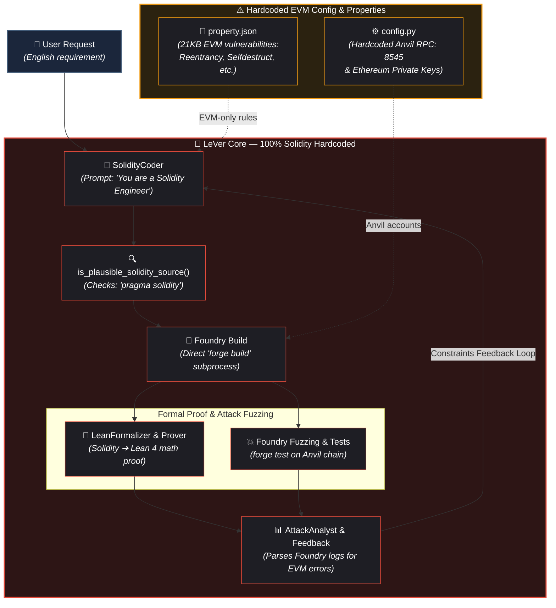
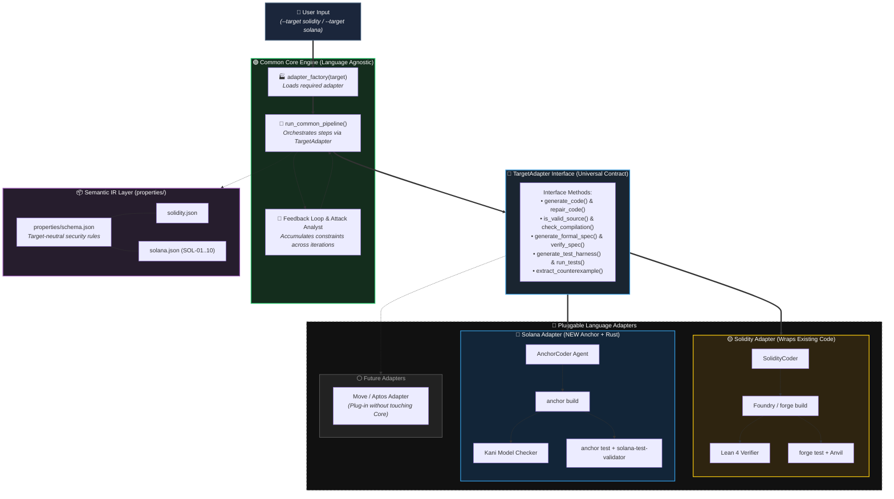
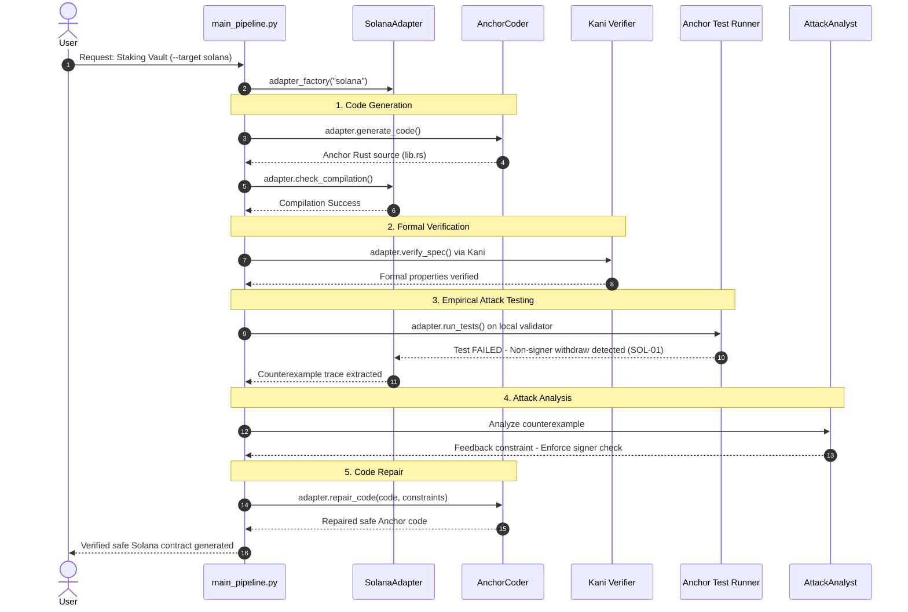

# LeVer Phase 0 Design: Solana Generalization
## Complete Beginner-Friendly & Rigorous Architectural Specification

> 💡 **Kisko Yeh Document Padhna Chahiye?**
> Chahe aapko blockchain, Solana, Rust ya formal verification bilkul na aati ho, yeh document padhne ke baad aapko har cheez crystal clear ho jayegi.
> Har topic ko 3 golden sawaalon se samjhaya gaya hai:
> 1. **Yeh kya hai?** (Concept kya hai + Real-world analogy)
> 2. **Yeh kyu hai / Kyu chahiye?** (Bina iske kya dikkat hoti hai)
> 3. **Kyon use karein?** (Yahi solution kyu chuna aur iska kya fayda hai)

---

## 0. Project Overview: LeVer Kya Hai Aur Hum Kya Kar Rahe Hain?

### 0.1 Yeh LeVer Kya Cheez Hai? (What is LeVer?)
* **Seedhe shabdon mein**: LeVer ek **Automated AI Robot Factory** hai jo smart contracts (blockchain programs) banati hai, unhe test karti hai, unpe attacks karwati hai, aur mathematically prove karti hai ki unme koi chori ya bug nahi hai.
* **Real-life analogy**: Maan lijiye aap ek safe (tijori) banana chahte hain. LeVer ek aisi factory hai jisme:
  1. Ek Mistri (Coder Agent) safe ka design banata hai.
  2. Ek Math Professor (Formal Verifier) geometry aur physics se check karta hai ki design safe hai ya nahi.
  3. Ek Chor (Adversarial Tester) hathoda le kar safe todne ki koshish karta hai.
  4. Agar safe toot gayi, toh ek Analyst mistri ko batata hai ki kahan taala kamzor tha, aur mistri usko theek karta hai jab tak safe 100% unbreakable na ho jaye.

### 0.2 Humara Mission Kya Hai? (Solana Generalization)
* **Pehle kya tha**: LeVer sirf **Ethereum / Solidity** (EVM) ki tijori banana janta tha. Uske saare auzaar (tools) sirf Ethereum ke the.
* **Hum kya kar rahe hain**: Hum LeVer ko **Solana** (jo Anchor + Rust bhasha me banti hai) ke liye bhi capable bana rahe hain.
* **Sabse badi shart**: Hum pura system dobara nahi likhenge! Hum ek **Adapter Pattern (Universal Socket)** lagayenge, taaki purana Solidity ka kaam bhi chalta rahe, aur naya Solana bhi aasani se plug-in ho jaye.

---

## 1. Top-Line Decisions (D-01 se D-08) — Aasan Bhasha Mein

Yeh 8 sabse bade decisions hain jo humne Phase 0 mein finalize kiye hain:

| # | Decision Name | Chuna Hua Choice | Yeh Kya Hai? | Kyu Chahiye / Kyon Use Karein? |
|---|---------------|------------------|--------------|--------------------------------|
| **D-01** | Solana Target Framework | **Anchor + Rust** | Solana pe programs likhne ka sabse popular aur standard framework. | Raw Rust likhna bohot mushkil aur unsafe hota hai. Anchor 80% security checks (jaise signer verification) khud handle karta hai. |
| **D-02** | Formal Verifier for Solana | **Kani (Model Checker)** + Lean for Abstract Logic | Kani ek tool hai jo Rust code ke ek-ek logic path ko math se check karta hai. | Lean seedhe Rust code ko verify nahi kar sakta. Kani directly Rust code ko check karta bina translation ke. |
| **D-03** | Semantic IR (Intermediate Representation) | **Minimal JSON Schema** | Ek common language / format jo security rules ko describe karta hai. | Har blockchain ki terms alag hoti hain. Ek common format hone se core pipeline ko har bhasha ki alag headache nahi leni padti. |
| **D-04** | Adapter Contract Style | **Abstract Python Base Class (`TargetAdapter`)** | Ek "Contract" ya "Template" jo bolta hai: Har adapter ke paas yeh methods hone chahiye (`generate_code`, `run_tests`, etc.). | Isse Core Engine ko pata hota hai ki chahe Solana ho ya Solidity, functions ka naam same hoga. |
| **D-05** | Property Representation | **Target-Neutral JSON + Language Annotations** | Rules list jisme bataya gaya hai ki attack kaisa dikhta hai aur bachaav kaisa hona chahiye. | Taaki common bugs (jaise overflow) ek jagah rahein aur Solana-specific bugs (jaise PDA, Signer) apni alag jagah. |
| **D-06** | Testing Environment | **`solana-test-validator` + Anchor Test** | Ek local Solana blockchain jo aapke computer par chalti hai test karne ke liye. | Jaise Ethereum ke liye Anvil tha, waise hi Solana ke attacks run karne ke liye local test validator zaroori hai. |
| **D-07** | Property Files Split | `properties/solidity.json` + `properties/solana.json` | Purane `property.json` ko do alag files mein baantna. | Purani file mein sirf EVM ke bugs the. Solana ke naye bugs ke liye alag clean file chahiye. |
| **D-08** | Solidity Backward Compatibility | Wrap existing code in `SolidityAdapter` | Purana Solidity code todne ke bajaye use ek box (Adapter) me band kar dena. | Purani koi bhi cheez break nahi honi chahiye; production-grade backward compatibility maintain karni hai. |

---

## 2. Current Architecture & Identified Problems (Repository Reconnaissance)

### 2.1 Abhi Pipeline Kaise Chalta Hai? (Verified Workflow)
Repo ke andar main pipeline ka rasta yeh hai:
[`core/main_pipeline.py`](file:///d:/LeVer%20Testing/LeVer-Research/LeVer/core/main_pipeline.py) ➔ [`core/pipeline/workflows.py`](file:///d:/LeVer%20Testing/LeVer-Research/LeVer/core/pipeline/workflows.py) ➔ [`core/pipeline/iteration.py`](file:///d:/LeVer%20Testing/LeVer-Research/LeVer/core/pipeline/iteration.py)

```
User ki Requirement (Plain English text)
        │
        ▼  agents['coder'].generate_modern_code()
SolidityCoder (core/agents.py:1308) ➔ Solidity code generate karta hai
        │
        ▼  is_plausible_solidity_source()
Source Validation (core/pipeline/solidity_utils.py:3) ➔ "pragma solidity" check karta hai
        │
        ▼  simulator.check_compilation()
Foundry Compilation (core/simulator.py) ➔ "forge build" chalata hai
        │
        ├──▶ [LEAN PATH: Math Proof]
        │         LeanFormalizer.formalize_definitions() ➔ Definitions.lean
        │         LeanProver.prove_theorem() ➔ Proof.lean
        │         FormalVerifier.verify_file() ➔ lean CLI build
        │
        └──▶ [DYNAMIC PATH: Attack & Fuzzing]
                  EnvironmentArchitect.generate_safety_rules() ➔ SafetyRules.sol
                  SimulationRunner.run_fuzz_and_attack() ➔ forge test (Anvil par fuzzer)
                  AttackAnalyst.analyze_attack_structured() ➔ Log parse karke Mistri ko feedback deta hai
                        │
                        ▼
                  Feedback constraints ➔ Agle round mein SolidityCoder ko milta hai
```

### 2.2 Problem Kya Thi? (Coupling Points — Fevicol Problem)
Humne code inspect karke paya ki pura system Solidity ke sath buri tarah bandha hua hai:

| File & Line | Hardcoded Cheez | Problem Kya Hai? (Bina Adapter ke kyu fail hoga?) |
|-------------|-----------------|---------------------------------------------------|
| `core/config.py:7-40` | Anvil RPC URL (`8545`) + Ethereum private keys | Solana mein Anvil ya Ethereum keys ka koi wajood nahi hai. |
| `core/simulator.py:16` | Direct `forge build`, `forge test` calls | Foundry (`forge`) sirf Solidity compile kar sakta hai, Rust nahi. |
| `core/pipeline/solidity_utils.py:7` | `"pragma solidity"` check | Rust/Anchor code me `pragma solidity` kabhi nahi hoga, isliye validation fail ho jayegi. |
| `core/pipeline/workflows.py:98` | Variable ka naam `ctx.solidity_code` | Agar code Solana ka hai, tab bhi variable ka naam `solidity_code` rakha hua hai. |
| `core/agents.py:1308` | Prompt: *"You are a Solidity Security Engineer"* | Yeh LLM ko force karta hai sirf Solidity likhne ke liye. |
| `core/formal_verifier.py:64` | Sirf `.lean` extension allow karta hai | Agar hum Kani verifier ka `.rs` file denge toh yeh code crash ho jayega. |
| `property.json` (21KB) | Saare rules EVM-specific (Reentrancy, Delegatecall) | Solana me `delegatecall` ya `selfdestruct` jaisi cheezein exist hi nahi karti. |

---

## 3. Naya Solution: Adapter Pattern Architecture

### 3.1 Yeh Adapter Pattern Kya Hai? (The Universal Multi-Plug Analogy)
* **Real-life Example**: Maan lijiye aapke ghar ki deewar mein ek Universal Socket (Common Core) laga hai.
  * Agar aapko **Indian plug** lagana hai ➔ toh aap Indian pin ka adapter lagate hain (**SolidityAdapter**).
  * Agar aapko **US plug** lagana hai ➔ toh aap US pin ka adapter lagate hain (**SolanaAdapter**).
  * Deewar ki wiring (Core Pipeline) ko todne ki zaroorat bilkul nahi padti!

### 3.2 Diagram: Before vs After

#### 1. BEFORE (Purana System — Hardcoded)
Isme har component ek-dusre ke andar ghusa hua tha:




* **Red Boxes**: Har jagah Solidity hardcoded thi. Ek cheez badlo toh 10 jagah code fat jata tha.

---

#### 2. AFTER (Naya System — Adapter Pattern)
Isme universal core alag hai aur language-specific adapters alag:




* **Green Box (Common Core)**: Yeh main dimaag hai (`iteration.py`, feedback loop). Isko nahi pata ki peeche Solidity hai ya Solana. Yeh bas bolta hai: *"Code generate karo, test karo, report do."*
* **Middle Layer (`TargetAdapter`)**: Yeh contract/socket hai jo donon ko jodta hai.
* **Yellow Box (`SolidityAdapter`)**: Purana Solidity code bina ek line tode iske peeche chup gaya.
* **Blue Box (`SolanaAdapter`)**: Solana (Anchor + Rust + Kani) ka naya adapter.
* **White Box (Future)**: Kal ko Move, Aptos ya Cairo support karna ho, bas ek nayi file add karni hogi.

---

## 4. `TargetAdapter` Interface: Har Method Kya Karta Hai?

Har adapter ke paas yeh methods hone compulsory hain (abstract methods). Yeh unka matlab aur zaroorat hai:

```python
# core/adapters/base.py (Abstract Base Class)
from abc import ABC, abstractmethod
from typing import List, Dict, Tuple

class TargetAdapter(ABC):

    # 1. Code Generation
    @abstractmethod
    def generate_code(self, requirement: str, constraints: List[str]) -> str:
        """
        YEH KYA HAI: AI se target language ka smart contract likhwaney ka function.
        KYU CHAHIYE: Solidity ke liye SolidityCoder chalega, Solana ke liye AnchorCoder.
        """

    @abstractmethod
    def repair_code(self, current_code: str, requirement: str, constraints: List[str]) -> str:
        """
        YEH KYA HAI: Jab attack se bug pakda jaye, toh mistri ko bolna ki code repair kare.
        KYU CHAHIYE: Purane bug ko repeat kiye bina naya safe code generate karne ke liye.
        """

    # 2. Source Validation & Build
    @abstractmethod
    def is_valid_source(self, code: str) -> bool:
        """
        YEH KYA HAI: Pehle hi check karna ki code sahi language me hai ya rubbish text hai.
        KYU CHAHIYE: Solidity me 'pragma solidity' dhoondta hai, Solana me 'use anchor_lang'.
        """

    @abstractmethod
    def check_compilation(self) -> Tuple[bool, str]:
        """
        YEH KYA HAI: Compiler chala kar dekhna ki syntax error toh nahi hai.
        KYU CHAHIYE: Solidity ke liye 'forge build', Solana ke liye 'anchor build'.
        """

    # 3. Formal Verification
    @abstractmethod
    def generate_formal_spec(self, source_code: str, properties: List[str]) -> str:
        """
        YEH KYA HAI: Math proof ke liye specification file banana.
        KYU CHAHIYE: Solidity ke liye 'Definitions.lean' banta hai, Solana ke liye Kani harness stub.
        """

    @abstractmethod
    def verify_spec(self, spec_content: str, spec_filename: str) -> List[str]:
        """
        YEH KYA HAI: Verifier run karke check karna ki saare theorems prove hue ya fail.
        KYU CHAHIYE: Lean CLI ya 'cargo kani' run karta hai.
        """

    # 4. Empirical Testing & Attack
    @abstractmethod
    def generate_test_harness(self, source_code: str, properties: List[str],
                              semantic_obligations: List[Dict]) -> Dict[str, str]:
        """
        YEH KYA HAI: Attack scripts aur fuzz tests generate karna.
        KYU CHAHIYE: Chor ke liye test cases banana jo alag-alag tarike se code todne aayenge.
        """

    @abstractmethod
    def run_tests(self) -> Tuple[bool, str]:
        """
        YEH KYA HAI: Test runner ko execute karna aur logs capture karna.
        KYU CHAHIYE: Solidity ke liye 'forge test', Solana ke liye 'anchor test'.
        """

    @abstractmethod
    def extract_counterexample(self, test_log: str) -> Dict:
        """
        YEH KYA HAI: Agar attack kamyaab ho gaya, toh log se nikaalna ki attack KAISE hua.
        KYU CHAHIYE: AI Analyst ko exact proof dena taaki wo code sudhaar sake.
        """
```

---

## 5. Semantic IR (Intermediate Representation): Yeh Kya Hai Aur Kyu Chahiye?

### 5.1 Yeh Kya Hai? (The Multi-Lingual Dictionary Analogy)
* Maan lijiye do log hain — ek Hindi bolta hai aur ek Japanese. Beech mein ek English translator hai.
* Yahan English translator humara **Semantic IR (JSON format)** hai!
* **Problem**: Ethereum bolta hai *"Reentrancy via fallback"*, Solana bolta hai *"Cross-instruction state desynchronization"*. Donon ka concept alag hai par goal same hai: *"Funds safe rehne chahiye."*
* **Solution**: Humne ek minimal JSON schema banaya jo security rules ko target-neutral banata hai.

### 5.2 Minimal IR Schema Example (Arithmetic Overflow)
```json
{
  "id": "L1.1-Overflow",
  "name": "Integer Overflow / Underflow",
  "target_neutral": true,
  "invariant_template": "Koi bhi calculation limit se zyada hone par chupchap wrap nahi honi chahiye",
  "annotations": {
    "solidity": {
      "code_check": "unchecked { ... } block safe hona chahiye ya Solidity 0.8+ default use karo",
      "tool": "Foundry fuzzer / Slither"
    },
    "solana": {
      "code_check": "a.checked_mul(b).ok_or(ErrorCode::Overflow)?",
      "tool": "Kani assert / Anchor error"
    }
  }
}
```

---

## 6. Solana Ke 10 Safety Properties (SOL-01 se SOL-10): Chor Kaun Hai Aur Kaise Rokte Hain?

Solana blockchain par 10 sabse common hacks kaunse hote hain? Humne inka poora catalog taiyar kiya hai:

| Property ID | Bug Ka Naam | Yeh Kya Hai? (Aasan Bhasha Mein) | Real-World Attack (Chor Kya Karta Hai?) | Hum Kaise Rokte Hain? |
|-------------|-------------|-----------------------------------|-----------------------------------------|------------------------|
| **SOL-01** | Missing Signer Check | Check na karna ki permission dene wale ne sach me sign kiya hai ya nahi. | Attacker bank me ja kar bolta hai: *"Yeh Raha Admin Ka Naam, paise mere account me daal do"* — aur bank bina signature check kiye paise de deta hai! | Anchor ka `#[account(signer)]` rule check karta hai ki transaction me asli signature hai. |
| **SOL-02** | Account Ownership Validation | Yeh check na karna ki account kis program ka hai. | Attacker ek nakli passbook khud print karta hai aur bank ko dikha kar paise le leta hai. | `account.owner == expected_program_id` check karke nakli accounts reject karte hain. |
| **SOL-03** | PDA & Bump Validation | Program-Derived Address (jo program ka vault hota hai) ka address galat nikaalna. | Vault ka asli address chhod kar kisi aur address ko vault maan lena aur paise nikal lena. | `find_program_address` ka canonical bump verify kiya jata hai Kani se. |
| **SOL-04** | Duplicate Account Aliasing | Do alag-alag accounts ki jagah ek hi account pass kar dena. | Transfer instruction me `Sender` aur `Receiver` ki jagah apna hi account do baar de diya, jisse calculation confuse ho gayi. | Instruction me check lagate hain: `from.key != to.key`. |
| **SOL-05** | CPI Program-ID Validation | Dusre program ko call karte waqt uska ID check na karna. | Real Token Program ke bajaye chor apna nakli program pass kar deta hai jo hamesha "Success" return karta hai. | Call karne se pehle check karo ki target program ID sach me official SPL Token program hai. |
| **SOL-06** | Sysvar Account Validation | Ghadi (Clock) ya Rent ka system account nakli hona. | Chor ek nakli Clock account bhejta hai jisme time 10 saal aage dikha kar lock hue tokens unlock kar leta hai. | Verify karo ki Clock account ka public key official `sysvar::clock::ID` hi hai. |
| **SOL-07** | Arithmetic Overflow | Number itna bada ho jana ki limit cross karke 0 ban jaye. | `balance = balance * 100` karne par number itna bada hua ki wrap hokar `0` ho gaya ya saste me saare tokens mil gaye. | Rust mein `checked_add()` aur `checked_mul()` lagana compulsory karte hain. |
| **SOL-08** | Signer & Authority Mismatch | Sign toh kisi ne kiya, par permission kisi aur ki use ho gayi. | Check kiya ki `User A` ne sign kiya, par action `Admin` ke naam pe le liya. | Verify karo ki Signer ka public key hi us resource ka Owner/Authority hai. |
| **SOL-09** | State Transition Invariant | Status ka illegal change ho jana (jaise 'Closed' account se withdraw). | Tijori band ho chuki hai, par ek function ne bina check kiye dubara paise baant diye. | Lean FSM (Finite State Machine) se prove karte hain ki transitions strictly legal hain. |
| **SOL-10** | CPI Cross-Instruction Assumptions | Ek hi transaction me do instructions se state badal dena. | Ek instruction me token transfer initiate kiya, dusri me beech me state manipulate kar li. | State check aur balance update ko ek-sath atomic rakhte hain. |

---

## 7. Threat Model: EVM vs Solana Ka Asli Farak

Dono blockchains fundamentally alag kaam karti hain. Agar aapko EVM aati hai toh yeh table aapko Solana ka fundas clear kar degi:

```
┌─────────────────────────────────┐       ┌─────────────────────────────────┐
│        ETHEREUM (EVM)           │       │            SOLANA               │
├─────────────────────────────────┤       ├─────────────────────────────────┤
│ • Code aur Data ek hi jagah     │       │ • Code alag (Program), Data alag│
│   (Contract ke storage slots me)│       │   (Accounts me store hota hai)  │
│                                 │       │                                 │
│ • msg.sender ek hi hota hai     │       │ • Ek sath multiple Signers      │
│   (caller ka address)           │       │   ho sakte hain transaction me  │
│                                 │       │                                 │
│ • Contract ke andar storage hai │       │ • Program stateless hota hai!   │
│                                 │       │   Accounts bahar se pass hoti   │
│                                 │       │                                 │
│ • Reentrancy: Fallback function │       │ • Runtime reentrancy block      │
│   se contract me wapas ghusna   │       │   karta hai; cross-instruction  │
│                                 │       │   risk hota hai                 │
└─────────────────────────────────┘       └─────────────────────────────────┘
```

---

## 8. Verification Strategy: Lean vs Kani vs Empirical Testing

Security check karne ke 3 alag-alag level hain. Inka fark samajhna bohot zaroori hai:

| Level | Tool | Yeh Kya Karta Hai? | Real-Life Analogy | Limit / Warning |
|-------|------|--------------------|-------------------|-----------------|
| **Level 1: Math Proof** | **Lean 4** | Ganit (Mathematics) ke theorem prove karta hai. | *"Kagaz pe pen-paper se prove karo ki 2 + 2 = 4"* | Yeh abstract logic prove karta hai, par actual compiled Rust code me bug ho sakta hai! |
| **Level 2: Automated Model Checker** | **Kani** | Rust code ke har if-else aur arithmetic boundary ko exhaustively test karta hai. | *"Car ka automatic computer simulator crash test"* | Bohot complex Solana runtime functions ko stub/mock karna padta hai. |
| **Level 3: Dynamic Fuzzing & Attacks** | **`solana-test-validator` + Anchor Test** | Asli local blockchain par hacker bhej kar attack karwata hai. | *"Real-life mein chor ko hathoda de kar tijori pe attack karwana"* | Sirf wahi attacks check hote hain jo test script me likhe gaye hain (infinite scenarios test nahi ho sakte). |

---

## 9. Sequence Diagram: Ek Request Kaise Process Hoti Hai?

Yeh diagram dikhata hai ki jab User prompt deta hai toh system andar se kaise chalta hai:



---

## 10. Ordered Implementation Roadmap (Phase 0 se Phase 6)

| Phase | Kaam Kya Hai? | Estimated Time | Result / Output |
|-------|---------------|----------------|-----------------|
| **Phase 0** *(Abhi)* | Architecture & Decisions Finalize Karna | Current | Yeh complete design doc + approval |
| **Phase 1** | Adapter Interface Banana (`TargetAdapter`) | 1 Week | `base.py` aur `solidity_adapter.py` ready; existing Solidity tests pass |
| **Phase 2** | Semantic IR & Property Split | 3-4 Days | `properties/solana.json` aur `properties/solidity.json` split complete |
| **Phase 3** | Solana Code Generation | 2 Weeks | `AnchorCoder` agent ready jo Anchor/Rust code generate aur compile karta hai |
| **Phase 4** | Solana Formal Verification | 2 Weeks | Kani model checker integration + spec generation |
| **Phase 5** | Solana Empirical Attack Testing | 3 Weeks | Local validator setup + adversarial account substitution tests |
| **Phase 6** | End-to-End Integration | 1 Week | `--target solana` flag se poora system automated run hota hai |

---

## 11. Final Summary: Ek Line Mein Poora Khel

> 🎯 **Bottom Line**:
> Humne LeVer ke purane "Solidity-only" dimag ko todne ke bajaye ek **Universal Adapter Pattern** de diya hai.
> Ab chahe **Ethereum (Solidity)** ho ya **Solana (Anchor + Rust)**, core pipeline wahi rehti hai — bas adapter badal jata hai, aur contract 100% automated tariqe se generate, verify aur attack-test ho jata hai!
